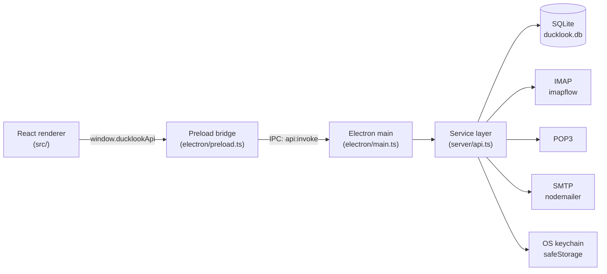

# DuckLook

**A local-first desktop email client for IMAP, POP3, and SMTP — with mail, calendar, contacts, and tasks in one calm workspace.**

DuckLook is a privacy-minded alternative to webmail and cloud-only mail clients. Your messages, events, contacts, and to-dos live in a local SQLite database on your computer. There is no DuckLook account, no telemetry, and no local HTTP server: the UI talks to the Electron main process over a locked-down IPC bridge.

[](https://github.com/rt8digital/ducklook/actions/workflows/ci.yml)
[](LICENSE)
[](#quick-start)
[](https://www.electronjs.org/)
[](https://react.dev/)
[](https://www.typescriptlang.org/)

> **Project status:** early, actively developed, and open to contributors. Windows is the primary packaged target today; macOS and Linux run from source and can be packaged with electron-builder.

---

## Why DuckLook?

- **Local-first by design.** Mail is downloaded into SQLite. Calendar, contacts, and tasks are stored beside it.
- **No DuckLook cloud.** There is no sign-up, sync service, analytics, or telemetry.
- **Credentials stay in the OS keychain.** Mailbox passwords are encrypted with Electron `safeStorage` (Windows DPAPI, macOS Keychain, libsecret on Linux).
- **A real desktop workflow.** Keyboard shortcuts, reading pane, rules, signatures, automatic replies, attachments, and multi-account support.
- **Hackable.** React + TypeScript + Electron, a small IPC surface, and no hidden web backend.

## Features

### Mail
- Multi-account IMAP and POP3 inboxes, with SMTP sending
- Provider presets for Gmail, Microsoft 365 / Outlook.com, and Fastmail
- Standard folders, custom folders, and per-account sync
- Unified or per-folder search with filters and sorting
- Reading pane, reply / reply-all / forward, drafts, attachments
- Bulk actions: read, unread, flag, archive, delete
- HTML mail rendering sanitized with DOMPurify
- Signatures, inbox rules, and automatic replies

### Calendar, people, and tasks
- Month / week / agenda calendar with local events
- RSVP support for calendar invitations
- Contact records with quick compose actions
- Task list with completion state
- A "My Day" drawer that pulls the day together

### Desktop experience
- Light and dark themes
- Global keyboard shortcuts
- Responsive layout with a mobile-style navigation rail
- Empty-slate onboarding: add your first mailbox, nothing is pre-seeded
- Windows NSIS installer and unpacked builds via electron-builder

### Keyboard shortcuts

| Key | Action |
| --- | --- |
| `C` | Compose a new email |
| `/` | Focus global search |
| `↑` / `↓` | Navigate messages |
| `R` | Reply to selected message |
| `F` | Forward selected message |
| `Del` | Delete selected message(s) |
| `Esc` | Close the active dialog or drawer |
| `?` | Open the shortcut guide |

## Tech stack

| Layer | Technology |
| --- | --- |
| Renderer | React 19, TypeScript, Vite, Tailwind CSS, lucide-react |
| Desktop shell | Electron 38 |
| Main process | Node.js, `better-sqlite3`, `imapflow`, `mailparser`, `nodemailer` |
| IPC | `contextBridge` + `ipcRenderer.invoke` with `contextIsolation` and `sandbox` |
| Storage | SQLite (WAL mode) in Electron's per-user `userData` directory |
| Packaging | electron-builder (Windows NSIS first) |

## Architecture



**No localhost HTTP server is used.** The renderer cannot reach the filesystem, SQLite, or the network stack directly. Every request crosses the narrow preload bridge and is dispatched by the main process.

## Quick start

### Prerequisites

- **Node.js 20.19+** (Node 22 LTS recommended)
- **npm** 10+
- A C++ build toolchain for native modules:
  - **Windows:** Visual Studio Build Tools with the "Desktop development with C++" workload
  - **macOS:** Xcode Command Line Tools (`xcode-select --install`)
  - **Linux:** `build-essential`, `python3`, and the usual Electron runtime libraries
- A mailbox that supports IMAP or POP3, plus SMTP for sending

### Install and run

```bash
git clone https://github.com/rt8digital/ducklook.git
cd ducklook
npm install
npm run dev
```

`npm install` runs `electron-builder install-app-deps` so `better-sqlite3` is rebuilt for Electron's ABI. `npm run dev` builds the main/preload bundles, starts Vite on port 5173, and launches Electron with renderer HMR.

### First launch

1. Choose a provider preset or enter your IMAP/POP3 and SMTP settings manually.
2. Add your mailbox password or app password.
3. DuckLook creates the standard folders and performs the first sync.
4. Add more accounts later from **Settings → Accounts**.

## Scripts

| Command | What it does |
| --- | --- |
| `npm run dev` | Build Electron bundles, start Vite, and launch the app |
| `npm run build` | Production renderer build plus Electron main/preload bundles |
| `npm run build:renderer` | Vite production build only |
| `npm run build:main` | esbuild the Electron main and preload processes |
| `npm start` | Run the built app with Electron |
| `npm run lint` | TypeScript type-check (`tsc --noEmit`) |
| `npm run test:api` | Electron integration test for SQLite + the IPC service layer |
| `npm run package` | Build a Windows NSIS installer in `release/` |
| `npm run package:dir` | Build an unpacked Windows app in `release/win-unpacked/` |

## Packaging

```bash
npm run package       # NSIS installer
npm run package:dir   # unpacked build, faster for smoke testing
```

Packaged artifacts land in `release/`. The current configuration is Windows-first. The app has no code-signing certificate configured, so Windows SmartScreen may warn on first launch. To sign releases, add your certificate configuration to the `build.win` section of `package.json` or provide the usual electron-builder environment variables.

macOS and Linux can run from source today. Adding `dmg` / `AppImage` targets to `build` is a good first packaging contribution.

## Configuration

| Variable | Default | Purpose |
| --- | --- | --- |
| `DUCKLOOK_DATA_DIR` | Electron `userData/data` | Override the SQLite data directory |
| `DUCKLOOK_TEST_DIR` | temporary directory | Reuse a fixed directory for the API integration test |
| `VITE_DEV_SERVER_URL` | unset | Used internally by `npm run dev` to load Vite |

Copy [`.env.example`](.env.example) if you want a local reference; DuckLook does not load `.env` files automatically.

### Where data lives

| Platform | Database |
| --- | --- |
| Windows | `%APPDATA%\DuckLook\data\ducklook.db` |
| macOS | `~/Library/Application Support/DuckLook/data/ducklook.db` |
| Linux | `~/.config/DuckLook/data/ducklook.db` |

On first launch, DuckLook copies a legacy `Outlook Desktop` database into the new DuckLook data directory if one exists. WAL and SHM sidecar files are copied too. A custom `DUCKLOOK_DATA_DIR` disables this migration and is used as-is.

> **Back up before experimenting.** The SQLite database is the source of truth. Copy the whole `data` directory while the app is closed.

## Account setup notes

DuckLook currently authenticates with a username and password, including provider-issued **app passwords**.

- **Gmail:** enable 2-Step Verification, then create an App Password. Use `imap.gmail.com:993` (TLS) or `pop.gmail.com:995` (TLS) and `smtp.gmail.com:465` (TLS). Regular account passwords will not work.
- **Microsoft 365 / Outlook.com:** Microsoft increasingly requires OAuth2 for modern auth. If your tenant allows IMAP/SMTP with app passwords, use `outlook.office365.com:993` and `smtp.office365.com:587` (STARTTLS). Full OAuth2 support is on the roadmap and is a welcome contribution.
- **Fastmail:** use an app password with `imap.fastmail.com:993` and `smtp.fastmail.com:465`.
- **Self-hosted / other providers:** enter host, port, and security mode manually. Prefer TLS on port 993 for IMAP, 995 for POP3, and 465 or 587 for SMTP.

If the first sync fails, DuckLook still creates the account and local folders, then surfaces a sync warning so you can correct the settings.

## Security model

- `contextIsolation: true`, `nodeIntegration: false`, and `sandbox: true`.
- The renderer only sees `window.ducklookApi` with `invoke` and `saveAttachment`.
- Mailbox passwords are encrypted with `safeStorage`; if the OS keychain is unavailable, the value is explicitly tagged and obfuscated rather than silently corrupted.
- External links open in the system browser; in-app navigation to arbitrary URLs is blocked.
- HTML email is sanitized with DOMPurify before rendering.
- No telemetry, analytics, crash reporting, or DuckLook servers.

Found a security issue? Please follow [SECURITY.md](SECURITY.md) instead of opening a public issue.

## Project layout

```text
ducklook/
├─ electron/
│  ├─ main.ts            # app lifecycle, window, IPC handlers, DB migration
│  └─ preload.ts         # contextBridge API exposed to the renderer
├─ server/
│  ├─ api.ts             # service layer and route dispatch
│  ├─ db.ts              # SQLite schema and connection
│  ├─ crypto.ts          # safeStorage credential encryption
│  ├─ types.ts           # shared server-side types
│  └─ protocols/         # IMAP, POP3, and SMTP clients
├─ src/
│  ├─ components/        # mail, calendar, contacts, tasks, settings UI
│  ├─ utils/api.ts       # renderer wrapper around window.ducklookApi
│  ├─ App.tsx            # application shell and state
│  └─ types.ts           # renderer/shared types
├─ scripts/              # dev, build, test, and packaging helpers
├─ .github/              # CI, issue templates, PR template
├─ CONTRIBUTING.md
├─ SECURITY.md
└─ LICENSE
```

## Testing

```bash
npm run lint      # TypeScript type-check
npm run test:api  # Electron integration test
npm run build     # verify production bundles
```

`npm run test:api` starts Electron headlessly against a temporary data directory and exercises the real service layer: account creation, folder setup, drafts, message state, calendar events, contacts, tasks, rules, settings persistence, and bootstrap reload. It does not contact a mail server.

When contributing protocol changes, add a focused test where practical. Network-facing code should fail gracefully and report a useful sync warning.

## Troubleshooting

**`better-sqlite3` fails to load or rebuild**
Run `npm install` again. On Windows, confirm the Visual Studio "Desktop development with C++" workload is installed. On Linux, install `build-essential` and `python3`.

**The app opens to a blank window**
Run `npm run build` and then `npm start`, or use `npm run dev` and check the Vite and Electron terminals for errors.

**Login fails on Gmail**
Use an App Password, not your normal Google password. Confirm IMAP is enabled in Gmail settings.

**Microsoft 365 login fails**
Your account may require OAuth2. Check whether app passwords / basic auth are enabled for your tenant. OAuth2 is not implemented yet.

**Sync warning after adding an account**
The account and local folders were created, but the initial network sync failed. Open **Settings → Accounts**, verify host/port/security, and sync again.

**Where is my data?**
See [Where data lives](#where-data-lives). Back up the `data` directory while the app is closed.

## Contributing

Contributions are welcome — bug reports, provider presets, protocol fixes, UI polish, docs, and packaging targets.

1. Read [CONTRIBUTING.md](CONTRIBUTING.md).
2. Look for issues labelled `good first issue` or `help wanted`.
3. Fork, branch, make a focused change, and open a pull request.
4. Run `npm run lint`, `npm run test:api`, and `npm run build` before submitting.

Please follow our [Code of Conduct](CODE_OF_CONDUCT.md). By contributing, you agree that your contributions are licensed under the MIT License.

### Ideas worth building

- OAuth2 / PKCE for Microsoft 365 and Gmail
- CardDAV / CalDAV sync
- macOS and Linux packaging targets
- Threaded conversations and conversation search
- PGP / S-MIME support
- Mailto: protocol handler
- Attachment drag-and-drop and previews
- Accessibility and screen-reader audit
- Automated UI tests

## Roadmap

- [x] Local SQLite workspace with IMAP, POP3, and SMTP
- [x] OS keychain credential storage
- [x] Mail, calendar, contacts, tasks, rules, signatures, auto-replies
- [x] Windows packaging
- [ ] OAuth2 for Microsoft 365 and Gmail
- [ ] macOS and Linux release artifacts
- [ ] CardDAV / CalDAV
- [ ] Threaded conversations
- [ ] End-to-end encrypted mail support

Roadmap items are intentions, not promises. Open an issue to discuss scope before starting a large change.

## License

DuckLook is released under the [MIT License](LICENSE).

DuckLook is an independent project and is not affiliated with, endorsed by, or sponsored by Microsoft. "Outlook" and "Microsoft 365" are trademarks of Microsoft Corporation and are referenced only to describe mail-provider compatibility.

## Acknowledgements

Built with [Electron](https://www.electronjs.org/), [React](https://react.dev/), [Vite](https://vite.dev/), [`better-sqlite3`](https://github.com/WiseLibs/better-sqlite3), [`imapflow`](https://imapflow.com/), [`mailparser`](https://nodemailer.com/), and [`nodemailer`](https://nodemailer.com/). Thank you to the maintainers of those projects.
